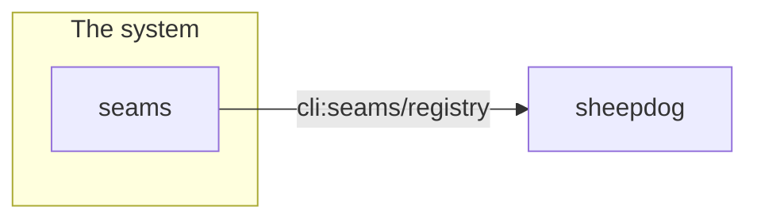

# Seams

<!-- Written by seams render, from the registry. Run it again rather than editing this file. -->

1 seam(s): 0 internal, 1 crossing out of the system.

## Components and seams

## Internal seams

None.

## Seams that cross out of the system

| Seam | Kind | Provider | Consumers | Audience | Contract | Deploys independently | Test world |
| --- | --- | --- | --- | --- | --- | --- | --- |
| `cli:seams/registry` | cli | seams (in this repo) | sheepdog (external) | public | schemas/ (owned by bitshepherds) | yes | provider: cmd/seams TestEachCommandsJSONOutputMatchesItsPublishedSchema, in the gate, with go test; provider: schemas TestSchemasAreCompatibleWithTheLastRelease, in the gate, with go test |

## History

| Date | Seams | Rung 0 | Rung 1 | Rung 2 | Rung 3 | Rung 4 | Rung 5 | Rung 6 | Not rated |
| --- | --- | --- | --- | --- | --- | --- | --- | --- | --- |
| 2026-10-23 | 1 | — | — | — | — | — | — | — | — |
